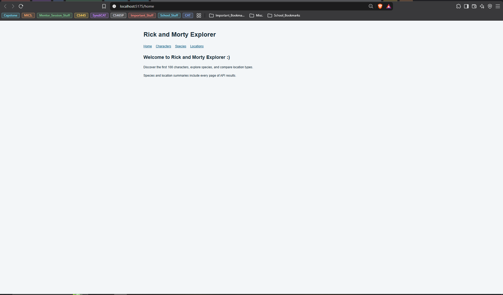
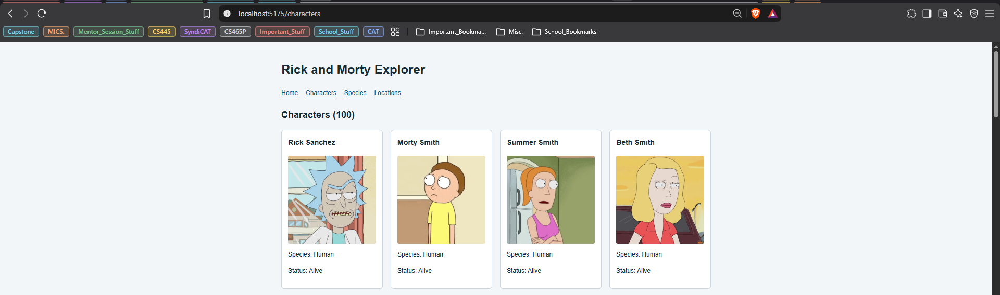
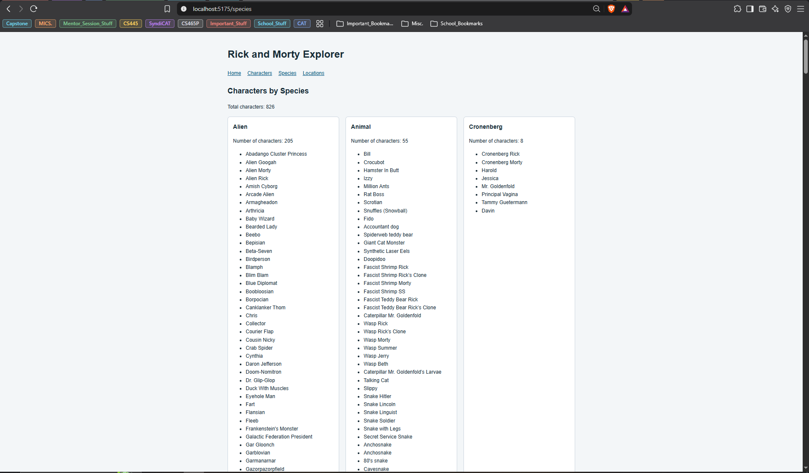
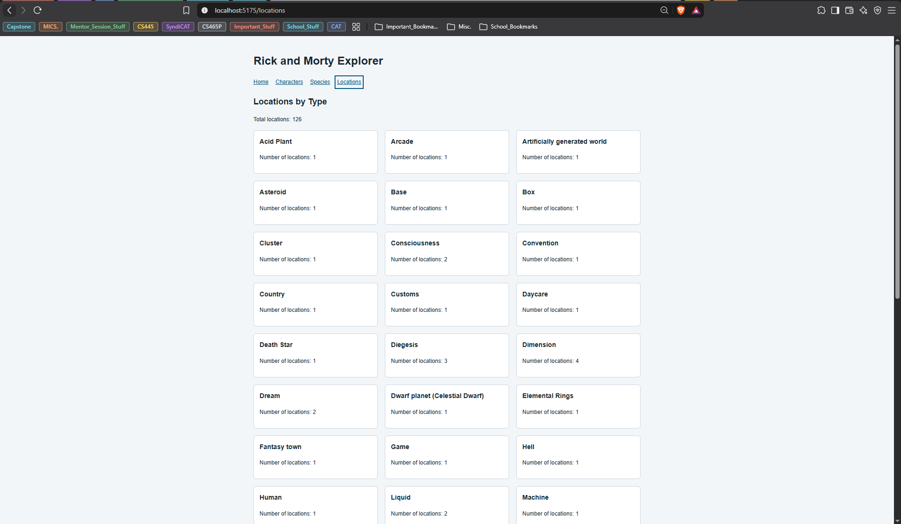

# Rick and Morty Explorer

A React application utilizing Vite, React Router, and the provided Rick and Morty API.

---

## Requirements

- Node.js 22.12 or newer; Node.js 24 is recommended.
- npm
- A modern browser and internet access (no brainer :) )

---

## Setup

From the directory:

```bash
npm install
```

This generates package-lock.json. Commit package.json and
package-lock.json, while excluding node_modules.

After cloning a repository with its lockfile, use:

```bash
npm ci
```

## Run

```bash
npm run dev
```

Open http://localhost:5174/home.

Stop the development server with Ctrl+C.

---

## Routes

- `/home`: Welcome message and navigation.
- `/characters`: First 100 characters, including their names,
  pictures, species, and status.
- `/species`: All characters grouped by species, including
  counts and character names.
- `/locations`: All locations counted by type.

---

## Data Handling

- Follows API pagination links.
- Caches successful pages in memory for five minutes.
- Displays loading messages and request errors.
- Cancels pending requests when leaving a page.
- Applies a 15-second timeout to each API request.
- Uses fallback text for missing or invalid fields.
- Displays a fallback when an image is missing or fails to load.
- Includes incomplete records in group counts.
- Displays an error instead of presenting partially fetched totals.

---

## Screenshots of Website

### Home Page



### Characters Page



### Species Page



### Locations Page



---

## Sources

- https://rickandmortyapi.com/documentation
- https://react.dev/reference/react/useEffect
- https://reactrouter.com/7.18.5/start/declarative/installation
- https://vite.dev/guide/
- https://github.com/airbnb/javascript
